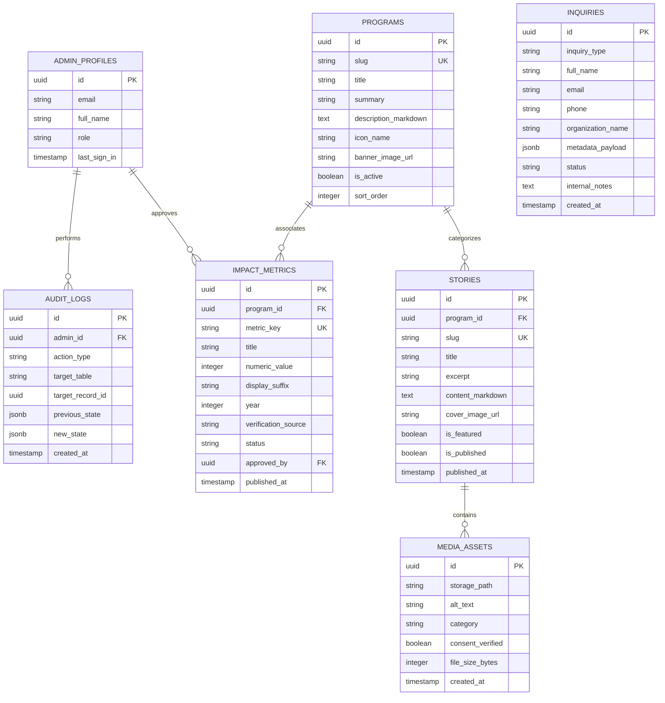

# Database Schema, Permissions & Row-Level Security Plan

**Project:** Sathiyavani Charitable Trust  
**Date:** October 2026  
**Document Status:** Schema Proposal for Phase 4 (Not Yet Created in Production)  

---

## 1. Data Modeling Objectives & Governance

1. **Least-Privilege by Default:** Anonymous web visitors have `SELECT` access *only* to published content and metrics.
2. **Strict Ingestion Isolation:** Form inquiries can be inserted (`INSERT`) by anonymous visitors through server-action validation, but cannot be read (`SELECT`), updated, or deleted by any unauthenticated actor.
3. **Auditability & Metric Governance:** All impact figures must undergo a documented state lifecycle (`draft` → `under_review` → `approved` → `published`) to prevent discrepancies.

---

## 2. Entity-Relationship (ER) Diagram



---

## 3. Data Dictionary & Table Specifications

### 3.1 `admin_profiles`
- **Purpose:** Store operational role and contact information for authenticated trust leaders.
- **Primary Key:** `id` (references `auth.users.id` via Supabase Auth).
- **Fields:**
  - `email` (TEXT, NOT NULL, UNIQUE)
  - `full_name` (TEXT, NOT NULL)
  - `role` (TEXT, NOT NULL, CHECK: `'super_admin'`, `'editor'`, `'viewer'`)
- **Privacy Classification:** Confidential.
- **Access Control:** Super Admin reads/writes; self reads.

---

### 3.2 `programs`
- **Purpose:** Public details, schedules, and objectives of trust programs.
- **Fields:**
  - `id` (UUID, PK, DEFAULT gen_random_uuid())
  - `slug` (TEXT, NOT NULL, UNIQUE)
  - `title` (TEXT, NOT NULL)
  - `summary` (TEXT, NOT NULL)
  - `description_markdown` (TEXT, NOT NULL)
  - `is_active` (BOOLEAN, DEFAULT true)
- **Privacy Classification:** Public.
- **Access Control:** Public reads active; Admin creates/updates.

---

### 3.3 `impact_metrics`
- **Purpose:** Authoritative, verified figures for beneficiaries, gifts, students, and trees.
- **Fields:**
  - `id` (UUID, PK)
  - `program_id` (UUID, REFERENCES programs(id), NULLABLE)
  - `metric_key` (TEXT, NOT NULL, UNIQUE e.g. `'cumulative_beneficiaries'`)
  - `title` (TEXT, NOT NULL)
  - `numeric_value` (INTEGER, NOT NULL)
  - `display_suffix` (TEXT, DEFAULT `'+'`)
  - `year` (INTEGER, NOT NULL)
  - `verification_source` (TEXT, NOT NULL e.g. `'Diwali 2024 Physical Register #3'`)
  - `status` (TEXT, NOT NULL, CHECK: `'draft'`, `'under_review'`, `'approved'`, `'published'`)
  - `approved_by` (UUID, REFERENCES admin_profiles(id), NULLABLE)
  - `published_at` (TIMESTAMPTZ, NULLABLE)
- **Privacy Classification:** Public once published; Internal audit notes confidential.
- **Access Control:** Public reads `status = 'published'`; Admins read/write all.

---

### 3.4 `inquiries`
- **Purpose:** Central repository for all web inbound inquiries (Volunteers, Student Sponsors, Corporate CSR, General).
- **Fields:**
  - `id` (UUID, PK)
  - `inquiry_type` (TEXT, NOT NULL, CHECK: `'volunteer'`, `'sponsorship'`, `'corporate_csr'`, `'general'`)
  - `full_name` (TEXT, NOT NULL)
  - `email` (TEXT, NULLABLE)
  - `phone` (TEXT, NOT NULL)
  - `organization_name` (TEXT, NULLABLE)
  - `metadata_payload` (JSONB, NOT NULL) - Stores form-specific fields (e.g., teaching subjects for volunteers, budget for CSR).
  - `status` (TEXT, NOT NULL, DEFAULT `'new'`, CHECK: `'new'`, `'contacted'`, `'in_progress'`, `'closed'`, `'spam'`)
  - `internal_notes` (TEXT, NULLABLE)
  - `created_at` (TIMESTAMPTZ, DEFAULT now())
- **Privacy Classification:** Highly Confidential (Personal Identifiable Information - PII).
- **Access Control:** Anonymous users cannot read any record. Authenticated Admins have `SELECT` and `UPDATE` access.

---

## 4. PostgreSQL Row Level Security (RLS) Policy Matrix

```sql
-- Enable RLS on all tables
ALTER TABLE admin_profiles ENABLE ROW LEVEL SECURITY;
ALTER TABLE programs ENABLE ROW LEVEL SECURITY;
ALTER TABLE impact_metrics ENABLE ROW LEVEL SECURITY;
ALTER TABLE stories ENABLE ROW LEVEL SECURITY;
ALTER TABLE media_assets ENABLE ROW LEVEL SECURITY;
ALTER TABLE inquiries ENABLE ROW LEVEL SECURITY;
ALTER TABLE audit_logs ENABLE ROW LEVEL SECURITY;

-- 1. Programs: Public can view active programs
CREATE POLICY "Public can view active programs" 
ON programs FOR SELECT 
USING (is_active = true);

-- 2. Impact Metrics: Public can only view published metrics
CREATE POLICY "Public can view published impact metrics" 
ON impact_metrics FOR SELECT 
USING (status = 'published');

-- 3. Inquiries: Anonymous can insert via validated server actions, cannot read
CREATE POLICY "Service role can insert inquiries" 
ON inquiries FOR INSERT 
WITH CHECK (true);

CREATE POLICY "Only authenticated admins can view inquiries" 
ON inquiries FOR SELECT 
TO authenticated 
USING (true);

CREATE POLICY "Only authenticated admins can update inquiry status" 
ON inquiries FOR UPDATE 
TO authenticated 
USING (true);
```

---

## 5. Metric Publication Lifecycle

```
[ New Field Measurement ]
           │
           ▼
     [ Status: DRAFT ] (Coordinator inputs raw count & register reference)
           │
           ▼
  [ Status: UNDER REVIEW ] (Trustee verifies documentation & physical registers)
           │
           ▼
    [ Status: APPROVED ] (Sign-off recorded in audit_logs with admin ID)
           │
           ▼
   [ Status: PUBLISHED ] (Now visible on public homepage & impact dashboard)
```

---

## 6. Unresolved Data Decisions for Phase 2-4
1. **Donor Tax Exemption Records:** Should PAN numbers be collected on pledge forms? *Recommendation: Do not collect PAN on website until 80G certificate is officially issued to reduce security liability.*
2. **Inquiry Data Retention:** Should volunteer and general inquiry records be automatically expunged after 24 months? *Recommendation: Yes, implement automated anonymization for closed inquiries.*
