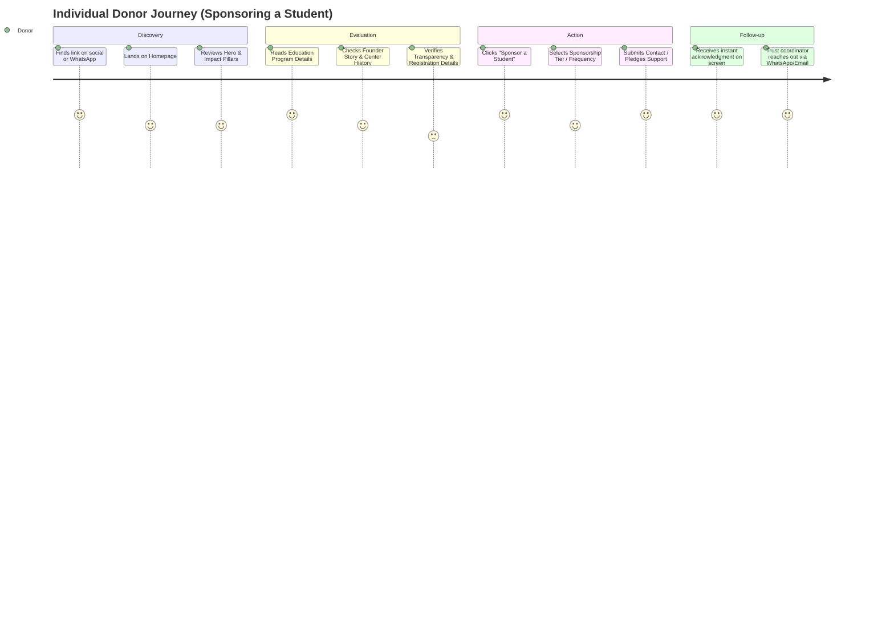
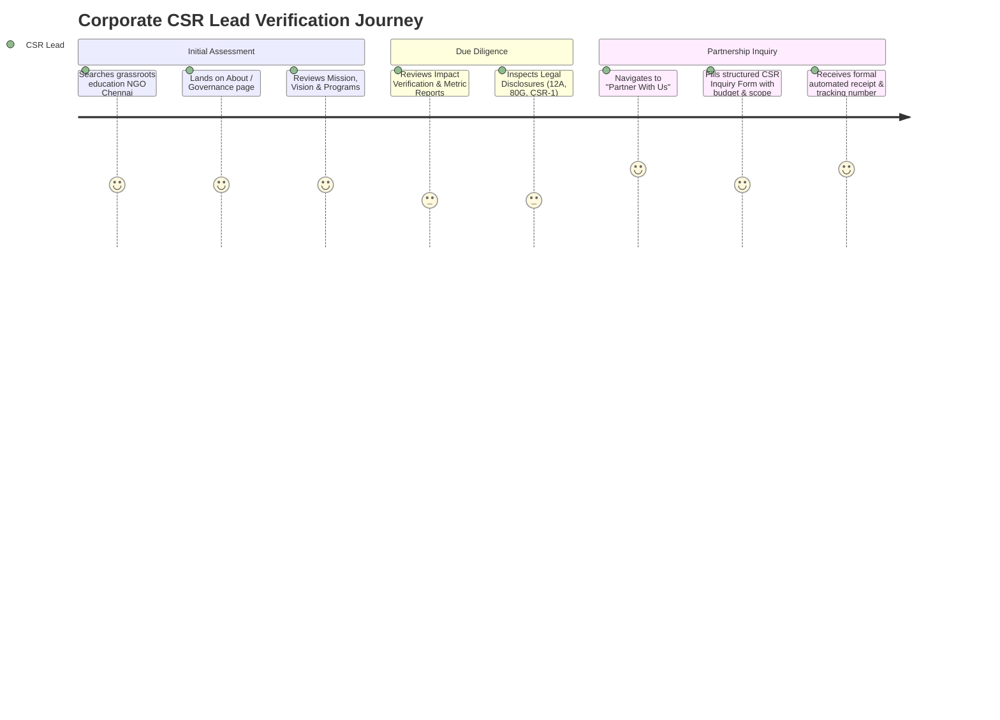
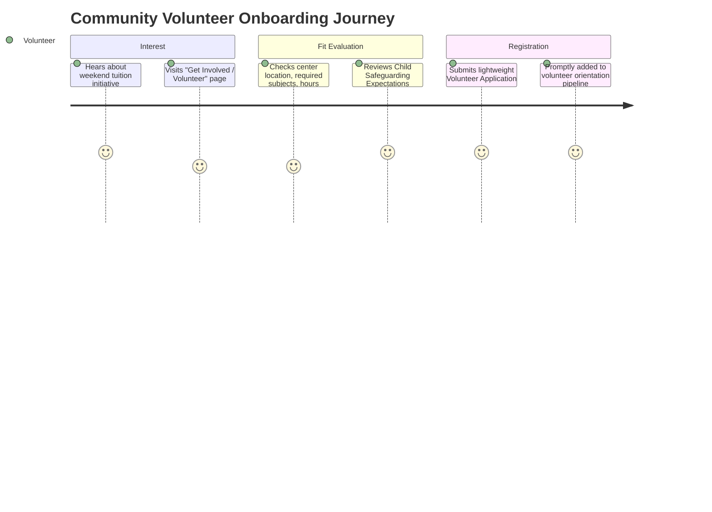

# User Personas & User Journeys: Sathiyavani Charitable Trust

**Project:** Sathiyavani Charitable Trust Website  
**Date:** October 2026  
**Status:** Initial Product Assumptions & Behavioral Models  

---

## 1. Overview & Research Methodology

The personas and journey maps defined below represent initial behavioral hypotheses based on standard nonprofit digital engagement models, philanthropic decision-making patterns in India, and the specific programmatic footprint of Sathiyavani Charitable Trust. 

*Note: These assumptions must be validated through direct stakeholder interviews with Mr. Raghu N., active volunteers, and prospective corporate partners.*

---

## 2. Core User Personas

### Persona A: The Conscientious Individual Donor
- **Representative Name:** Ananya Sharma, 34, Senior IT Consultant (Chennai/Bengaluru).
- **Core Motivation:** Wants to sponsor a child's education or support festive distribution locally, seeking authentic grassroots impact rather than large corporate NGOs.
- **Primary Concerns:**
  - "Is my money reaching the children directly, or lost in administrative overhead?"
  - "Can I get an 80G tax exemption receipt?"
  - "Is this trust legitimate and registered?"
- **Required Information:** Clear breakdowns of educational costs (e.g., ₹500/month or ₹6,000/year for school fees/kit), official bank/UPI details, 80G status, verified photos of centers.
- **Expected Actions:** Visits site on mobile, reviews founder story and education program, clicks "Sponsor a Student", copies UPI ID or submits sponsorship inquiry form.
- **Potential Barriers:** Broken links, absence of tax receipt guarantees, unverified claims, no online confirmation.

---

### Persona B: The Corporate CSR / Institutional Partner
- **Representative Name:** Rajesh Ramanathan, 45, CSR Committee Head, Manufacturing Firm (Chennai).
- **Core Motivation:** Looking to allocate mandatory Corporate Social Responsibility (CSR) funds towards localized education and biodiversity/environmental projects with measurable KPIs.
- **Primary Concerns:**
  - "Does the trust have CSR-1 registration, 12A, 80G, and valid PAN/Darpan ID?"
  - "Can the organization provide audited utilization certificates and quarterly outcome reports?"
- **Required Information:** Governance structure, audited balance sheets, corporate partner track record (e.g., Exnora collaboration proof), measurable metrics.
- **Expected Actions:** Lands via desktop, checks "About & Governance", downloads Annual Impact Summary, submits Corporate Partnership proposal form.
- **Potential Barriers:** Lack of formal governance documentation, unprofessional design, lack of downloadable reports.

---

### Persona C: The Dedicated Volunteer / Youth Advocate
- **Representative Name:** Karthik Vignesh, 21, Undergraduate Engineering Student (Chennai).
- **Core Motivation:** Seeking weekend community service hours to teach math/English, coordinate sports days, or assist in environmental clean-ups.
- **Primary Concerns:**
  - "Where is the center located? What are the weekend time commitments?"
  - "Can I get a certificate of volunteer service?"
- **Required Information:** Tuition center schedules, address/landmarks (e.g., library center), specific volunteer roles needed (teaching, arts, event coordination).
- **Expected Actions:** Finds site through social media or word of mouth, reads "Get Involved → Volunteer", fills short volunteer application with availability and skills.
- **Potential Barriers:** Complicated multi-step applications, absence of a physical address or contact point.

---

### Persona D: The Parent / Beneficiary Community Member
- **Representative Name:** Lakshmi K., 38, Domestic Worker and Single Mother of two (Chennai).
- **Core Motivation:** Needs free after-school tuition and school fee assistance for her 8-year-old child so the child does not fall behind.
- **Primary Concerns:**
  - "Is this tuition genuinely free or are there hidden fees later?"
  - "Is the center safe, respectful, and encouraging for my child?"
- **Required Information:** Plain language (Tamil/English), center location, timings, enrollment process, phone number to speak directly with the coordinator.
- **Expected Actions:** Browses via budget smartphone, taps "Call Coordinator" or WhatsApp icon to ask questions directly in Tamil.
- **Potential Barriers:** Heavy English academic jargon, slow-loading assets, complex online portals requiring logins.

---

### Persona E: The Trust Administrator / Operations Coordinator
- **Representative Name:** Trust Administrator (Mr. Raghu N. / Designated Operations Volunteer).
- **Core Motivation:** Efficiently manage inquiries, upload photos of recent distributions, publish verified annual impact numbers, and keep contact details current.
- **Primary Concerns:**
  - "I don't know React or coding; can I update this without breaking the website?"
  - "Are the volunteers' and donors' phone numbers secure from spammers?"
- **Required Information:** Simple, secure, password-protected dashboard, submission notifications, easy media uploader.
- **Expected Actions:** Logs in on laptop/phone, reviews new volunteer and sponsorship submissions, approves draft metrics, exports contacts to CSV.
- **Potential Barriers:** Over-engineered interfaces, fragile server environments, complicated deployment pipelines.

---

## 3. User Journey Maps

### 3.1 Individual Donor Journey (Sponsorship Conversion)

---

### 3.2 Corporate Partner Journey (CSR Engagement)

---

### 3.3 Volunteer Onboarding Journey

---

## 4. Accessibility, Language & Safeguarding Considerations

1. **Bilingual Requirement (English & Tamil):**
   A substantial portion of local parents and community members in Chennai communicate primarily in Tamil. Key informational summaries and call-to-action buttons should support Tamil localisation in subsequent phases.
2. **Mobile-First for Constrained Devices:**
   Beneficiaries and local volunteers frequently use budget Android smartphones on 3G/4G networks. Bundle size, image compression, and zero layout shift are critical for accessibility.
3. **Child Safeguarding & Dignity:**
   - Beneficiary children's full names, home addresses, or personal vulnerabilities must never be published online.
   - All photographs must have signed parental consent on file.
   - Portrayals of children must emphasize dignity, agency, and celebration of learning rather than poverty exploitation.
